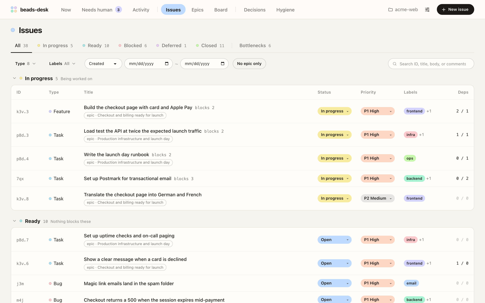
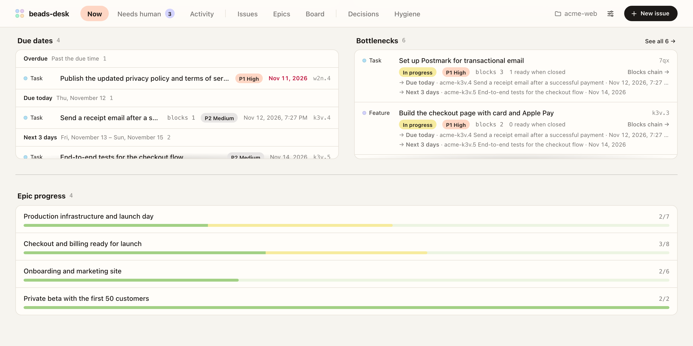
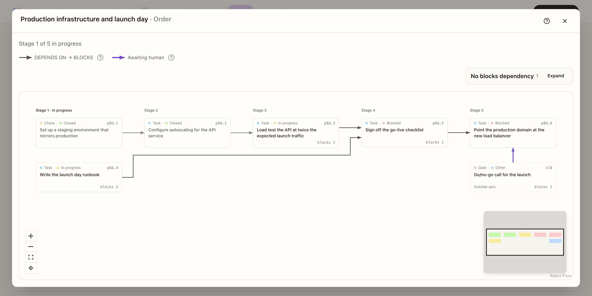
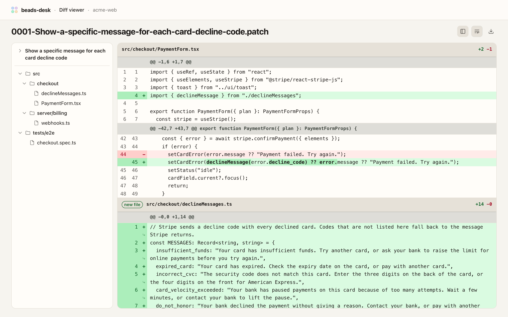
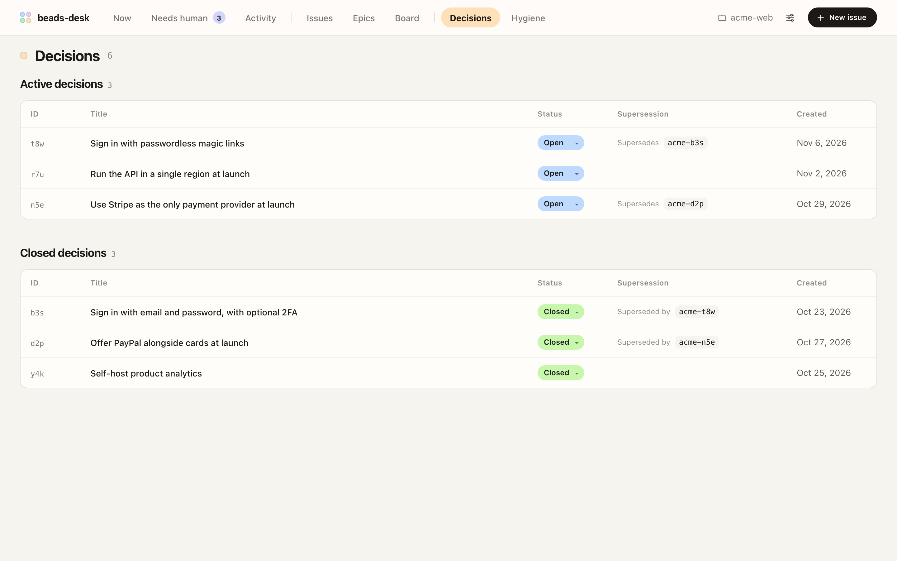
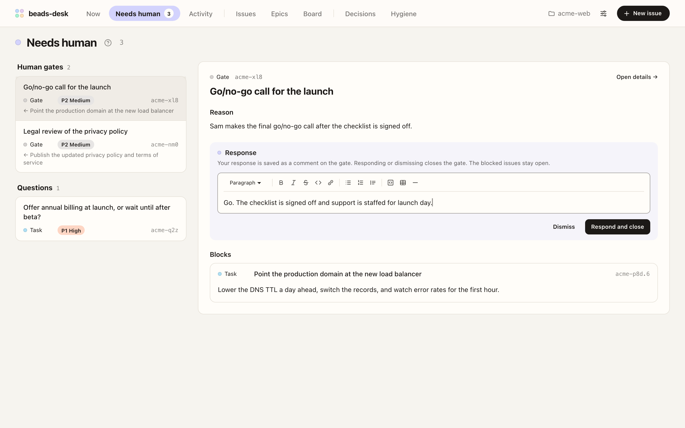
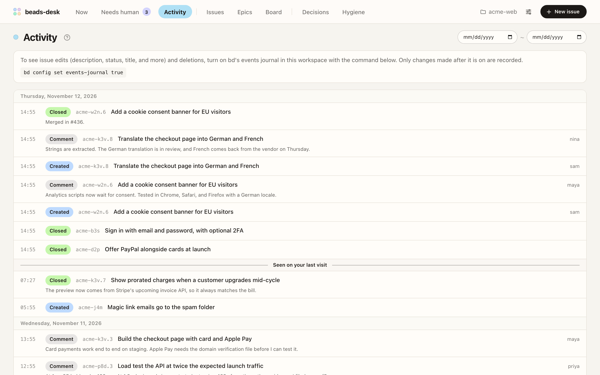
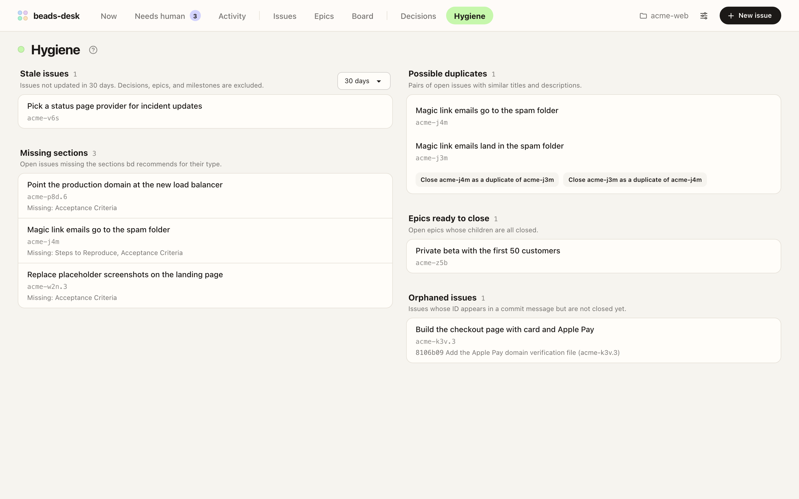

# beads-desk

🇺🇸 [English](https://github.com/seungyeop-lee/beads-desk/blob/main/README.md) | 🇰🇷 [한국어](https://github.com/seungyeop-lee/beads-desk/blob/main/README.ko.md) | 🇯🇵 日本語

エージェントが [Beads](https://github.com/gastownhall/beads)(`bd`)に残した記録をレビューするためのローカル Web UI です。エージェントが立てた計画、記録した決定、添付した図やスクリーンショット、人に残した質問をブラウザで読めます。ユーザーとエージェントがターミナルで `bd` を使っている間も、同じイシューをブラウザで確認・編集できます。

[](https://seungyeop-lee.github.io/beads-desk/beads-desk-intro.mp4)

## 機能

### すべてのイシューを作業状態ごとに見る

- **イシュー** 画面は、すべてのイシューを **進行中**、**着手可能**、**ブロック中**、**保留**、**クローズ** などの作業状態にまとめて表示します。タブで一つの状態や **ボトルネック** 表示だけを選べます。
- 種類、ラベル、作成日やクローズ日、**epic 未所属のみ** で一覧を絞り込みます。エピックに属するイシューには、そのエピックへのリンクが付きます。
- 検索は ID、タイトル、本文、コメントまで探し、検索語が本文やコメントのどこに出てくるかも表示します。
- イシューの状態と優先度は一覧から直接変更できます。



### 次に解除すべき作業を見つける

- **いま** 画面は、締め切りのあるオープンのイシューを **期限切れ**、**今日締め切り**、3日以内に分けて表示します。締め切りはイシューの詳細で設定・クリアします。
- **ボトルネック** は、ほかのイシューをブロックしているイシューを、待っているイシューが多い順に表示します。項目ごとに、待っているイシューのうち締め切りのあるイシューと、そのイシューをクローズするとすぐ着手可能になるイシューの数が表示されます。
- 全体の一覧は **イシュー** 画面の **ボトルネック** 表示にあります。
- 同じ画面で、進行中・着手可能・ブロック中のイシュー数、直近7日間のチャート、エピックの進捗も確認できます。



### 計画を段階ごとにレビューする

- エピックの **順序を表示** は、エピックのイシューを `blocks` 関係に沿って段階に分け、進行中の段階を示します。
- human gate と、エピックの外からブロックしているイシューも同じグラフに表示されます。
- **先行・後続グラフ** は、どのイシューからでも、そのイシューの前後の作業をつなげて表示します。



### エージェントが添付した資料を読む

- 説明とコメントの Markdown と Mermaid の図を描画します。図をクリックすると拡大できます。
- [ローカルファイルへのリンク](https://github.com/seungyeop-lee/beads-desk/blob/main/USAGE.ja.md#イシュー本文のローカルファイルリンク)はアプリ内で開きます。画像はイシューの中に表示され、`.webm` と `.mp4` の録画は再生されます。
- `.md`、`.markdown`、`.txt`、`.log`、`.json`、`.jsonl` へのリンクは[テキスト画面](https://github.com/seungyeop-lee/beads-desk/blob/main/USAGE.ja.md#テキスト画面)で開きます。Markdown はレンダリングし、テキストとログは原文で、JSON と JSONL は構文強調と Pretty/原文の切り替えで表示します。
- `.diff` と `.patch` へのリンクは、変更されたファイルをツリーで表示し長い行を折り返す [diff 画面](https://github.com/seungyeop-lee/beads-desk/blob/main/USAGE.ja.md#diff-画面)で開きます。
- これらのリンクの横の chevron ボタンは[段落の下にファイルの内容を展開します](https://github.com/seungyeop-lee/beads-desk/blob/main/USAGE.ja.md#イシュー画面でファイルの内容を展開する)。JSON と JSONL は Pretty で始まり、強調した原文に切り替えたり戻したりできます。




### 決定を記録に残す

- `decision` タイプのイシューを専用の画面に集め、有効な決定とクローズした決定に分けて表示します。
- 決定ごとに、その決定が置き換えた決定と、その決定を置き換えた決定へのリンクが表示されます。



### エージェントの質問に答える

- **判断待ち** 画面は、人に渡された質問(`human` ラベルが付いたイシュー)と確認依頼(human gate)を、各確認依頼がブロックしている作業とともにまとめて表示します。
- この画面ですぐに応答したり、応答せずにクローズしたりできます。確認依頼をクローズすると、その後ろにあった作業のブロックが解除されます。
- [ブラウザ通知](https://github.com/seungyeop-lee/beads-desk/blob/main/USAGE.ja.md#ブラウザ通知)をオンにすると、別のウィンドウで作業中でも新しい項目に気づけます。



### 離れている間に起きたことを確認する

- **アクティビティ** 画面は、workspace 全体でイシューを作成、クローズ、コメントした記録を新しい順に表示します。
- イシューを編集した記録(説明、状態、タイトル、ラベルなど)と削除した記録も、`bd config set events-journal true` で bd の events journal をオンにすると、オンにした後の変更から表示されます。
- **ここから前回見た記録** の区切り線が、前回どこまで見たかを示します。



### トラッカーを整理する

- **整理** 画面は、長く放置されたイシュー、コミットで言及されたのにまだオープンのイシュー、`bd` が推奨するセクションが抜けたイシュー、重複の候補、クローズできるエピックを見つけます。
- 重複の候補は同じ画面から重複としてクローズできます。



### そのほかの機能

| 画面     | 表示する内容                                                |
| -------- | ----------------------------------------------------------- |
| エピック | オープンとクローズのエピックの進捗、ID やタイトルで探す検索 |
| ボード   | ドラッグして状態を変えるカード                              |

- サイドパネルで、読んでいるイシューの横にリンクされたイシューを開けます。
- すべての読み取りと変更は `bd` CLI を通り、`bd` で変更した内容は数秒以内に開いているタブに反映されます。
- タブごとに別の workspace を表示できます。
- 画面は英語、韓国語、日本語と、ライト・ダークのテーマに対応しており、**設定** で切り替えます。

## 動作環境

- macOS、Linux、または Windows。`bd` 1.3.1 で、macOS と GitHub Actions の `windows-latest` runner でテストしています。Windows のテストでは beads-desk を npm でインストールし、embedded mode の workspace を使います。
- Node.js 22 以降
- `bd` CLI。`bd` が `PATH` にない場合は、サーバーを起動するときに `BD_BIN` 環境変数に実行ファイルのパスを設定します。
  - Windows では npm でインストールした `bd`(`npm install -g @beads/bd`)をサーバーが自動で見つけ、ほかの方法でインストールした `bd` が見つからない場合は[トラブルシューティング](https://github.com/seungyeop-lee/beads-desk/blob/main/USAGE.ja.md#トラブルシューティング)のとおり `BD_BIN` を設定します。
- beads workspace: `bd init` を実行したディレクトリ

## はじめに

1. npm でインストールします。

   ```sh
   npm install -g @seungyeop-lee/beads-desk
   ```

   pnpm でもインストールできます。pnpm でグローバルパッケージをインストールしたことがない場合は、先に `pnpm setup` を一度実行して新しいシェルを開きます。

   ```sh
   pnpm add -g @seungyeop-lee/beads-desk
   ```

2. beads workspace のディレクトリかそのサブディレクトリで、サーバーを起動します。

   ```sh
   bd-desk start --open
   ```

   サーバーはバックグラウンドで動作し、ブラウザで画面を開きます。`127.0.0.1` でのみリクエストを受け付けるので、このコンピューターからしか画面を開けません。

- **停止:** `bd-desk stop` を実行します。
- **アップデート:** インストールコマンドをもう一度実行してから、`bd-desk restart` を実行します。変更内容は[変更履歴](https://github.com/seungyeop-lee/beads-desk/blob/main/CHANGELOG.md)にあります。
- **詳しく:** [使い方ガイド](https://github.com/seungyeop-lee/beads-desk/blob/main/USAGE.ja.md)に、コマンド、オプション、複数の workspace の併用、通知、ローカルファイルへのリンク、アンインストール、トラブルシューティングがあります。

## コントリビューション

バグ報告と機能の提案は GitHub の issue で受け付けており、pull request は受け付けていません。詳しくは [CONTRIBUTING.md](https://github.com/seungyeop-lee/beads-desk/blob/main/CONTRIBUTING.md) をご覧ください。

## 謝辞

beads-desk は [mantoni/beads-ui](https://github.com/mantoni/beads-ui) に着想を得ています。

## ライセンス

[MIT](https://github.com/seungyeop-lee/beads-desk/blob/main/LICENSE)
